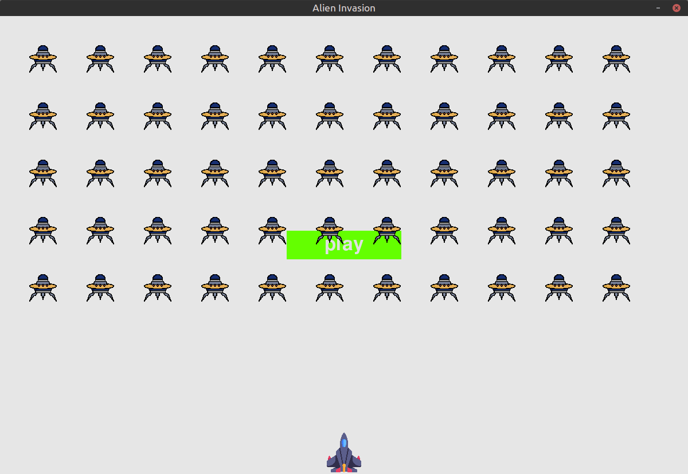

<div align="center">
  <!-- TODO: Convert ./images/ship.bmp to ship.png (transparent background) and update the path below -->
  
  <h1>Alien Invasion Pygame</h1>
  <p>A classic arcade shooter built with Pygame: shoot down the alien fleet before it reaches the bottom of the screen.</p>

  <a href="https://github.com/mu-omran/alien-invasion-pygame/blob/main/LICENSE">
    
  </a>
  <!-- TODO: Change 3.8%2B to the minimum Python version you actually tested on -->
  
  
  

<!-- TODO: Replace this screenshot with a short looping GIF of gameplay (under ~10 seconds), e.g. ./screenshots/gameplay.gif -->
<!-- TODO: Consider renaming the "Results" folder to "screenshots" or "docs" and updating the path -->


## ✨ Features

### Gameplay
- Start the game by pressing the `Play` button
- On-screen dashboard showing:
  - Current score (top right)
  - High score for the current session (top center)
  - Remaining lives (ships)

### For Developers
- Most game parameters can be tweaked in `settings.py`, such as ship speed, bullet speed, and more.

<!-- TODO: Add a 3-line snippet from your real settings.py here. Copy the actual variable names, for example:
```python
ship_speed = ...
bullet_speed = ...
```
-->

## 🎮 Controls

<!-- TODO: Fill in your actual controls. I can't see your code, so I didn't guess. Example format:
| Key | Action |
|---|---|
| ← / → | Move ship |
| Space | Shoot |
| Q | Quit |
-->

## 🚀 Quick Start

**Requirements:** Python 3.8+ <!-- TODO: confirm the version -->

1. Clone the repository:
   ```bash
   git clone https://github.com/mu-omran/alien-invasion-pygame.git
   cd alien-invasion-pygame
   ```

2. Create a virtual environment and activate it:
   ```bash
   python -m venv .venv

   # macOS / Linux
   source .venv/bin/activate

   # Windows
   .venv\Scripts\activate
   ```

3. Install dependencies:
   ```bash
   pip install pygame
   ```
   <!-- TODO: Add a requirements.txt (containing "pygame") to the repo, then replace the command above with:
   pip install -r requirements.txt -->

4. Run the game and enjoy!
   ```bash
   python alien_invasion.py
   ```

## 📁 Project Structure

```
alien-invasion-pygame/
├── alien_invasion.py   # Main game file, run this one
├── settings.py         # Game parameters (speeds, sizes, etc.)
├── images/             # Game sprites
└── Results/            # Screenshots
```
<!-- TODO: Add any other .py files (ship, bullet, alien, button, scoreboard, etc.) with one-line descriptions -->

## 🤝 Contributing

Contributions are welcome!

1. Fork the repository
2. Create a branch: `git checkout -b feature/your-feature`
3. Commit your changes and push the branch
4. Open a Pull Request

### Ideas / Roadmap
- [ ] Game Over screen
<!-- TODO: You wrote "Gratitude screen" originally. If you meant a "Thank you" screen, rename this item accordingly -->
- [ ] Instructions screen explaining how to play and the controls
- [ ] Multiple levels

## 🙏 Credits

<!-- TODO: If this project follows a tutorial or book (e.g. "Python Crash Council"/"Python Crash Course" by Eric Matthes), add a one-line acknowledgement here. Otherwise delete this section. -->

## 📄 License

Distributed under the [GNU GPL v3](LICENSE) license.
<!-- TODO: Make sure a LICENSE file exists in the repo root, otherwise the link and the license badge will not work -->