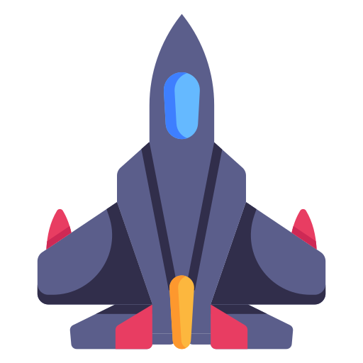
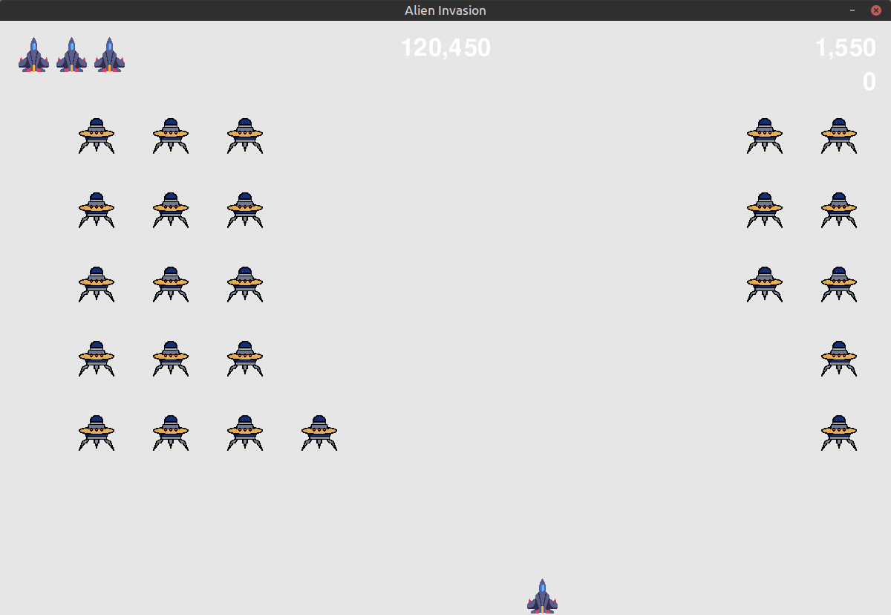

<div align="center">
  
  <h1>Alien Invasion Pygame</h1>
  <p>An arcade game where a ship shoots the alien fleet before it reaches the bottom of the screen.</p>


</div>



## ✨ Features

### Gameplay
- You can start the game by pressing the `Play` button.
- A dashboard shows:
    - Current score (top right)
    - High score of the current session (top center)
    - Remaining lives (ships)

### For Developers
- A lot of game parameters can be tweaked through the `settings.py` file. You can adjust features like ship speed, bullet speed, and more.

  Example from `settings.py`:

  ```python
  self.ship_speed = 1.5
  self.bullet_speed = 1.5
  self.alien_speed = 0.3
  ```

## 🎮 Controls

| Key | Action |
|---|---|
| ← / → | Move ship |
| Space | Shoot |
| Ctrl + Q | Quit |

## 🚀 Quick Start

1. Clone the repository:
    ```bash
    git clone https://github.com/mu-omran/alien-invasion-pygame.git
    cd alien-invasion-pygame
    ```

2. Create a virtual environment and activate it:

    **Note:** You should have Python installed.

    ```bash
    python -m venv .venv

    # macOS / Linux
    source .venv/bin/activate

    ```

3. Install dependencies:
    ```bash
    pip install pygame
    ```

4. Run the game and enjoy!
    ```bash
    python alien_invasion.py
    ```

## 📁 Project Structure

```
alien-invasion-pygame/
├── alien_invasion.py   # Main game file, run this one
├── alien.py            # Class to control the alien
├── bullet.py           # Class to control the bullet
├── button.py           # Class to control the button
├── game_stats.py       # Tracks game statistics
├── images/             # Game assets for 2D objects
├── README.md
├── scoreboard.py       # Class for the scoreboard
├── screenshots/        # Screenshots of the game
├── settings.py         # Game parameters (ship_speed, bullet_speed, ...)
└── ship.py             # Class for the ship
```

## 🤝 Contributing

Contributions are welcome!

1. Fork the repository
2. Create a branch: `git checkout -b feature/your-feature`
3. Commit your changes and push the branch
4. Open a Pull Request

### Ideas / Roadmap
- [ ] A polished start screen
- [ ] Instructions screen explaining how to play and the controls
- [ ] Multiple levels

## 📄 License

Distributed under the [GNU GPL v3](LICENSE) license.
